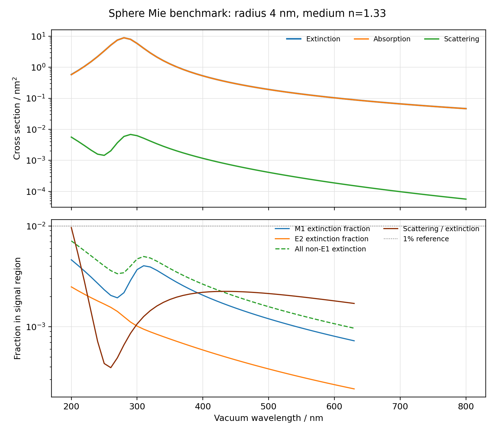
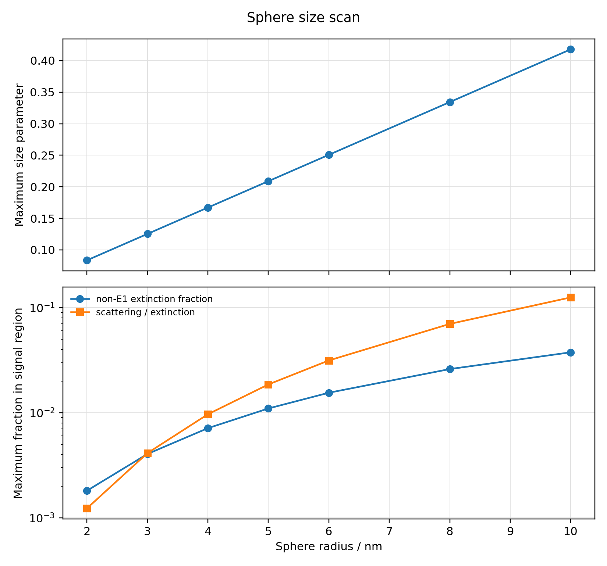

# CFO helix CD/MCD modeling

This repository collects a Python electric coupled-dipole workflow and a public research record for circular-dichroism (CD) and magneto-circular-dichroism (MCD) modeling in chiral particle assemblies.

The runnable seed package uses an explicitly synthetic Lorentz dielectric function. It contains no CFO material table, partner-provided experiment, unpublished manuscript, or value-revealing result derived from those materials. The bundled Mie benchmark checks the numerical implementation on a synthetic homogeneous sphere. Historical CFO-specific findings summarized in the research notes are not reproducible from this seed package alone.

## What is here

- `CDM_py/pycdm/`: Python 3N electric coupled-dipole solver, geometry, material interpolation, polarizability, and observables.
- `CDM_py/examples/synthetic_helix_demo.py`: a helical assembly example using synthetic optical input.
- `CDM_py/tests/sanity_checks.py`: lightweight checks for single-particle CD, mirror-sign reversal, and matrix dimensions.
- `data/`: generator, provenance note, manifest, and synthetic passive dielectric table.
- `benchmarks/mie_sphere/`: exact Mie-series comparison with electric-dipole approximations. The script writes detailed CSVs and a report under this folder when run.
- `docs/`: the research story, claim boundaries, and data-provenance rules.

The checked-in Mie snapshot uses only the synthetic input. Its passing validation checks coefficient sums, the energy identity, multipole convergence, and the dipole implementation. See the [benchmark report](benchmarks/mie_sphere/report/mie_sphere_benchmark.md), [validation JSON](benchmarks/mie_sphere/validation/b0_validation.json), [run manifest](benchmarks/mie_sphere/validation/b0_manifest.json), and [radius summary](benchmarks/mie_sphere/results/b0_radius_scan_summary.csv). The benchmark script can regenerate the full CSV outputs.





## Quick start

Python 3.11 or newer is recommended. From the repository root:

```powershell
python -m venv .venv
.\.venv\Scripts\Activate.ps1
python -m pip install -r requirements-cdm.txt
python .\CDM_py\tests\sanity_checks.py
python .\CDM_py\examples\synthetic_helix_demo.py
```

To run the independent sphere benchmark, install its optional dependencies and run:

```powershell
python -m pip install -r requirements-benchmark.txt
python .\benchmarks\mie_sphere\mie_sphere_benchmark.py
```

The same commands work on macOS/Linux after replacing the virtual-environment activation command with `. .venv/bin/activate` and using `/` in paths. The demo spectrum and large benchmark CSVs are generated locally and ignored by Git. The compact Mie report, validation record, radius summary, and plots are checked in.

The sanity checks verify that an isotropic single particle has zero CD within numerical tolerance, left/right mirror helices reverse the modeled CD sign, and the solver builds matrices of the expected dimensions. These checks validate code behavior for the stated synthetic input and ideal geometry; they do not validate a CFO material model or explain an experiment.

## Evidence boundary

The research notes summarize a longer project history, including results obtained with CFO and experimental inputs that are not included here. Those summaries are explicitly separated from the public synthetic runs. The public benchmark only tests a homogeneous isotropic sphere with synthetic input in a uniform, non-absorbing medium. It does not test magneto-optical tensor response, substrates, particle interactions, or a real CFO data set.

The pure-electric helix calculation is a reduced model. A magnetization-dependent dielectric tensor first changes a particle's electric response; a collective moment assembled from coupled electric dipoles is a cluster-level diagnostic. Neither object alone establishes the microscopic origin of experimental CD/MCD. Tensor-particle full-wave benchmarks, dimer and helix comparisons, and the complete R/S × +M/−M parity decomposition remain open tests. See [evidence and limitations](docs/evidence-and-limitations.md) before interpreting any project-history claim.

Partner-provided measurements, unpublished drafts, and results that reveal their values are excluded from this repository. For additional context, see [data provenance](docs/data-provenance.md) and the [research story](docs/research-story.md).

## Reuse and attribution

The project-authored code and documentation are distributed under the [MIT License](LICENSE). The Python workflow follows the solver structure and conventions of the MIT-licensed `CoupledDipole.jl` project, and its gold dielectric-function module includes a copied formula. See [third-party notices](THIRD_PARTY_NOTICES.md) for upstream attribution. The synthetic dielectric table is generated by the included script and is also covered by the repository MIT license.
